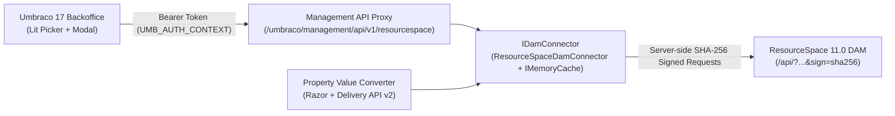

<p align="center">
  
</p>

# Bring Your Own DAM: ResourceSpace Connector for Umbraco 17

**By [Skye Technology](https://skye.technology)** — An open-source, MIT-licensed starter and Razor Class Library (`SkyeTechnology.Umbraco.ResourceSpace`), built as the companion repository for the *24 Days In Umbraco* article **"Bring Your Own DAM: Building a ResourceSpace Connector for Umbraco"**.

Editors can search, filter, preview, and pick **ResourceSpace** assets directly inside the **Umbraco 17 (Bellissima)** backoffice — and deliver responsive renditions to **Razor views** and the **Headless Content Delivery API** without copying files into Umbraco's media library.

---

## Architecture Overview



### Key Capabilities
- **Server-Side Signed Authentication**: Implements ResourceSpace's `sha256(privateKey + queryString)` request signing (`ResourceSpaceRequestSigner`) behind an authenticated Umbraco `ManagementApiControllerBase` so API keys never reach the browser.
- **Bellissima Backoffice Extension (`@skye-technology/umbraco-resourcespace-client`)**: TypeScript + Lit + Vite bundle registering a custom `propertyEditorUi` (`<resourcespace-asset-picker>`) and sidebar `modal` (`<resourcespace-picker-modal>`) with keyword search, resource-type filtering, thumbnail cards, rendition inspection, live DAM status refresh, and editorial alt-text overrides.
- **Single Source of Truth**: Stores only a compact `DamAssetReference` JSON object (`resourceId`, optional editorial `altText`, and lightweight fallback metadata) in Umbraco. Zero files are duplicated into `wwwroot/media`.
- **Dual Delivery (Razor + Headless)**: `ResourceSpacePropertyValueConverter` implements both `IPropertyValueConverter` and `IDeliveryApiPropertyValueConverter`, resolving web-optimised renditions, responsive `srcset` candidates, PDF download + cover preview URLs, and a `<dam-image>` Razor TagHelper.
- **Production Resilience**: Separate positive (`AssetCacheDuration`, default 10 min) and negative (`MissingAssetCacheDuration`, default 60 s) `IMemoryCache` TTLs, automatic suppression/fallback when DAM assets are restricted (`access != 0`), archived, or deleted, `PublicBaseUrl` CDN rewriting, and per-environment strongly typed `ResourceSpaceOptions`.
- **Swappable Abstraction (`IDamConnector`)**: Clean provider boundary ready to adapt to Bynder, Cloudinary, or Azure Blob Storage.

---

## Repository Structure

```text
├── docker/resourcespace/                       # Local ResourceSpace 11.0 + MariaDB 11.4 Docker stack
│   ├── seed-assets/                            # Bundled CC0 1.0 museum artworks + ATTRIBUTION.md
│   ├── seed-demo-assets.sh                     # Idempotent DAM bootstrap & asset seeder (supports --reseed)
│   ├── seed-demo-assets.php                    # Creates API service user & ingests 8 curated demo assets
│   └── fetch-royalty-free-assets.sh            # Re-downloads CC0 artworks from Art Institute of Chicago IIIF
├── docs/article.md                             # Companion "24 Days In Umbraco" article
├── umbraco-marketplace.json                    # Umbraco Marketplace listing manifest (Skye Technology)
├── src/
│   ├── SkyeTechnology.Umbraco.ResourceSpace/   # Reusable Razor Class Library (RCL) NuGet package
│   │   ├── Abstractions/                       # IDamConnector & provider-agnostic DAM DTOs
│   │   ├── Client/                             # @skye-technology/umbraco-resourcespace-client (TS + Lit + Vite)
│   │   ├── Composers/                          # AddResourceSpaceDam() DI registration & auto-composer
│   │   ├── Configuration/                      # ResourceSpaceOptions strongly-typed settings
│   │   ├── Controllers/                        # Management API proxy controller
│   │   ├── Models/                             # PublishedDamAsset model for Razor & Delivery API
│   │   ├── PropertyEditors/                    # DataEditor schema + PropertyValueConverter
│   │   ├── ResourceSpace/                      # SHA-256 request signer, HTTP client & connector
│   │   ├── TagHelpers/                         # <dam-image /> responsive Razor TagHelper
│   │   └── wwwroot/App_Plugins/                # Compiled ES module bundle & umbraco-package.json
│   └── SkyeTechnology.Umbraco.ResourceSpace.Demo/ # Umbraco 17.8.1 (.NET 10) SQLite demo site + DemoSchemaSeeder
└── tests/
    └── SkyeTechnology.Umbraco.ResourceSpace.Tests/ # xUnit test suite (signing, caching, governance, converter)
```

---

## Local Quickstart (Docker + .NET 10)

### Prerequisites
- [.NET 10 SDK](https://dotnet.microsoft.com/download/dotnet/10.0) (`10.0+`)
- [Docker Desktop](https://www.docker.com/products/docker-desktop/) (for local ResourceSpace 11.0 + MariaDB 11.4)
- Node.js `20+` *(optional — prebuilt backoffice assets are already included under `wwwroot/App_Plugins/ResourceSpace/`)*

### 1. Start Local ResourceSpace 11.0 DAM
```bash
docker compose -f docker/resourcespace/docker-compose.yml up -d --build
```

### 2. Seed Demo DAM Users & Curated CC0 Museum Assets
```bash
./docker/resourcespace/seed-demo-assets.sh
```
This idempotently configures ResourceSpace (`http://localhost:8085`), creates a dedicated `umbraco_api` service user, and ingests **8 curated CC0 1.0 Public Domain museum assets** (7 Art Institute of Chicago Open Access photographs bundled in `docker/resourcespace/seed-assets/` — see [`ATTRIBUTION.md`](docker/resourcespace/seed-assets/ATTRIBUTION.md) — plus an illustrated *2026 Annual Conservation Report* PDF generated at seed time). Pass `--reseed` to wipe and re-ingest the demo assets at any time:

```bash
./docker/resourcespace/seed-demo-assets.sh --reseed
```

| Service | URL | Credentials |
| :--- | :--- | :--- |
| **ResourceSpace Web UI** | `http://localhost:8085` | `admin` / `admin123` |
| **ResourceSpace API User** | `http://localhost:8085/api/` | `umbraco_api` *(key preconfigured in `appsettings.Development.json`)* |

### 3. Run the Umbraco 17 Demo Site
```bash
dotnet run --project src/SkyeTechnology.Umbraco.ResourceSpace.Demo
```
On startup, `DemoSchemaSeeder` automatically ensures the **ResourceSpace - Asset Picker** Data Type, the **Exhibition Page** Document Type & Template (`Views/exhibitionPage.cshtml`), and the published **Mediterranean Antiquity & Botanical Study** root page are up to date — showcasing:
- **Hero (`#1`)**: *Mosaic Floor Panel Depicting Marine Life* (Roman Marine Floor Mosaic, Daphne, 200–230 CE) with editorial alt-text override and responsive `srcset`
- **Curated Exhibition Plates**: Henri Fantin-Latour's *Botanical Study — Roses in a Bowl (1881)* (`#2`, automatic DAM caption fallback), *Athenian Belly-Amphora (550–540 BCE)* (`#5`), and Hubert Robert's *The Old Temple — Monumental Colonnade (1787)* (`#6`)
- **Archive Dossier (`#3`)**: Illustrated *2026 Annual Conservation Report (PDF)* with Ghostscript cover preview (`PreviewUrl`) and direct `.pdf` download (`Url`)
- **Restricted Governance (`#4`)**: *Portrait Head of Emperor Hadrian (Restricted Loan)* (`access=1`), cleanly suppressed by `<dam-image />` with a live governance banner (`UnavailableReason`)
- **Additional Picker Assets (`#7`, `#8`)**: *Illuminated Vellum Manuscript Leaf (c. 1450)* and *Byzantine Mosaic Fragment with Grazing Camel*, ready to search and pick in the backoffice modal

| Endpoint | URL | Login / Notes |
| :--- | :--- | :--- |
| **Public Exhibition Page (Razor)** | `http://localhost:5080/` | Streams live CC0 museum renditions & suppresses restricted `#4` |
| **Umbraco 17 Backoffice** | `http://localhost:5080/umbraco` | `admin@example.org` / `LocalDevPassword123!` |
| **Content Delivery API v2** | `http://localhost:5080/umbraco/delivery/api/v2/content` | Headless JSON output with `url`, `previewUrl`, `srcSet` & `renditions` |

---

## Using in Razor & Headless Delivery API

### Razor View (`<dam-image />`)
```cshtml
@using SkyeTechnology.Umbraco.ResourceSpace.Models
@addTagHelper *, SkyeTechnology.Umbraco.ResourceSpace
@{
    var hero = Model.Value<PublishedDamAsset>("heroAsset");
}

<dam-image asset="@hero"
           size="scr"
           sizes="(max-width: 1080px) 100vw, 1080px"
           loading="eager"
           css-class="hero-image" />
```

### Per-Environment Configuration
Keep API keys out of `appsettings.json` in source control and inject them per environment via environment variables or Azure Key Vault:

```bash
ResourceSpace__BaseUrl="http://resourcespace-internal.museum.local"
ResourceSpace__PublicBaseUrl="https://dam-cdn.museum.org"
ResourceSpace__ApiUser="umbraco_prod_api"
ResourceSpace__ApiKey="<secret-from-vault>"
ResourceSpace__AssetCacheDuration="00:10:00"
ResourceSpace__MissingAssetCacheDuration="00:01:00"
```

---

## Rebuilding the Backoffice Client, Packing & Running Tests

```bash
# Rebuild @skye-technology/umbraco-resourcespace-client (TypeScript / Lit / Vite)
npm --prefix src/SkyeTechnology.Umbraco.ResourceSpace/Client install
npm --prefix src/SkyeTechnology.Umbraco.ResourceSpace/Client run build

# Run the xUnit test suite
dotnet test SkyeTechnology.Umbraco.ResourceSpace.sln

# Build NuGet package (.nupkg + .snupkg)
dotnet pack src/SkyeTechnology.Umbraco.ResourceSpace -c Release
```

---

## License

Copyright (c) 2026 [Skye Technology](https://skye.technology). Released under the [MIT License](LICENSE).
