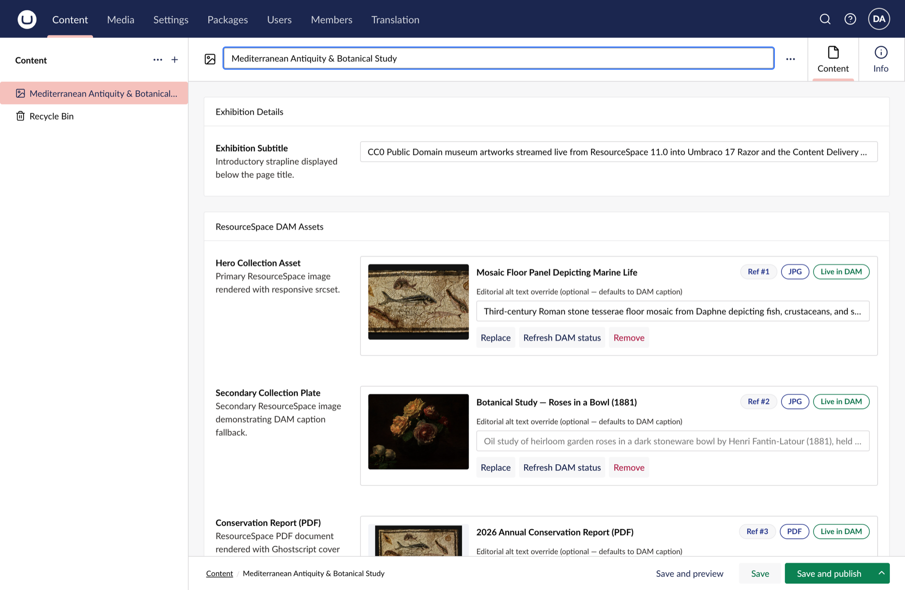
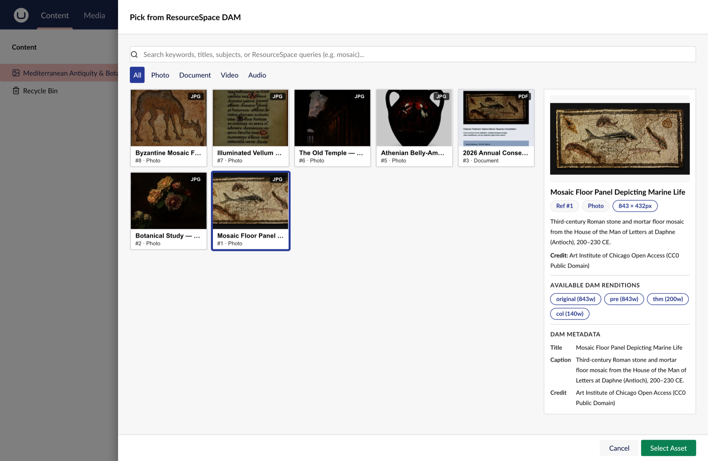
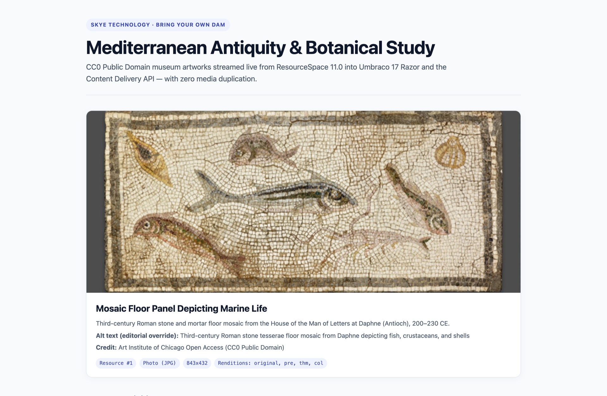
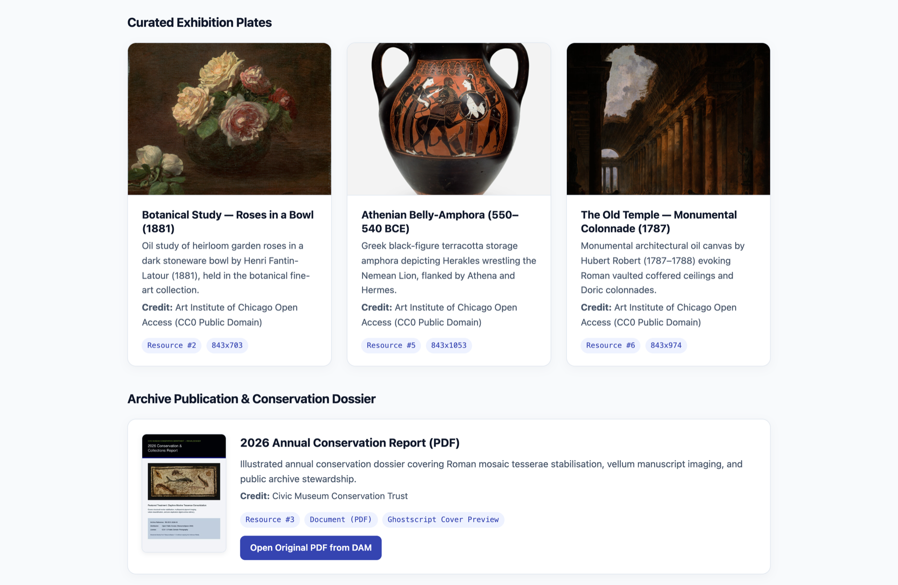
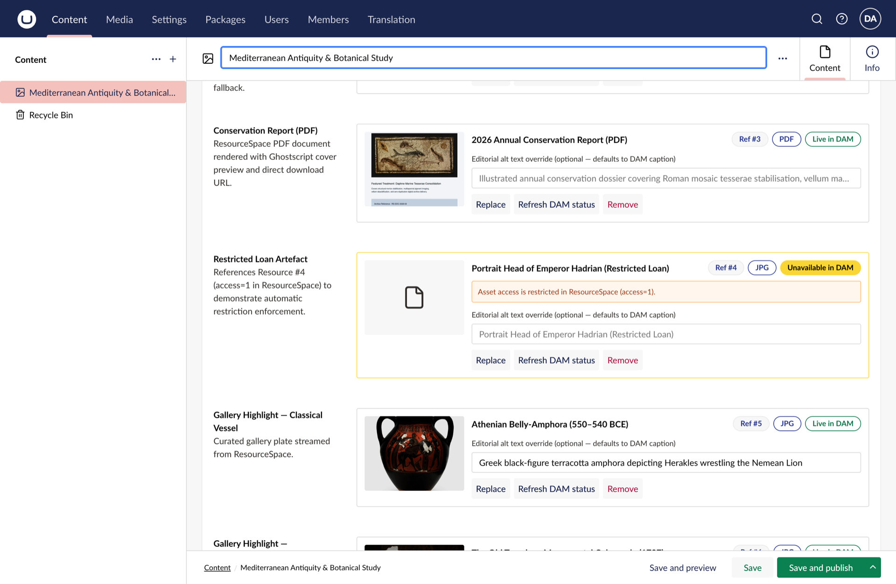
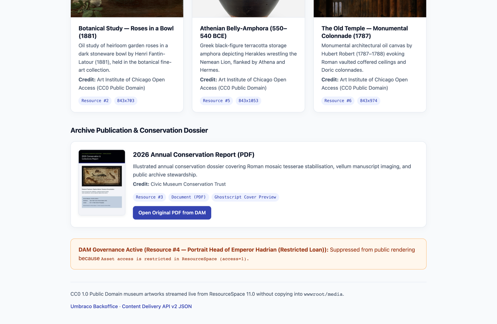

# Bring Your Own DAM: Building a ResourceSpace Connector for Umbraco

Museums, universities, charities, and public-sector organisations rarely start a website rebuild with an empty media folder. Usually, tens of thousands of high-resolution photographs, conservation PDFs, and archival videos already live in a dedicated Digital Asset Management (DAM) system—complete with rights metadata, photographer credits, and embargo rules.

**ResourceSpace** is one of the most widely adopted open-source DAMs in those sectors. Yet when teams pair it with Umbraco, editors often end up downloading JPEGs from ResourceSpace and re-uploading them into the Umbraco Media Library. Within months, captions drift out of sync, uncropped masters bloat `wwwroot/media`, and an image restricted by an archivist in the DAM remains publicly live on the website.

In this article, we will build a clean, modern **ResourceSpace connector for Umbraco 17** (`SkyeTechnology.Umbraco.ResourceSpace`) step by step. Editors will search, preview, and pick ResourceSpace assets directly inside the Bellissima backoffice, while Umbraco stores only a lightweight reference and delivers live DAM renditions to both Razor views and the Content Delivery API—without duplicating a single file.

---

## 1. The ResourceSpace API and Server-Side Signing

ResourceSpace exposes a JSON HTTP endpoint at `/api/`, authenticated using **signed query strings** rather than OAuth bearer tokens. Each API user has a private key, and every request must append a lowercase hexadecimal SHA-256 hash computed over `privateKey + queryString` (without the leading `?`).

Two details matter when implementing this in .NET:

1. **The private key must never reach the browser.** Because signing requires the raw API key, calling ResourceSpace directly from a backoffice web component would expose credentials in DevTools.
2. **Byte-identical query encoding.** ResourceSpace hashes the exact query string bytes it receives before `&sign=`. If `HttpClient` re-encodes spaces or UTF-8 characters differently after you compute the hash, ResourceSpace rejects the call with `Invalid signature`.

We solve deterministic signing in `ResourceSpaceRequestSigner` using `Uri.EscapeDataString` and `SHA256.HashData`:

```csharp
public static class ResourceSpaceRequestSigner
{
    public static string BuildSignedRelativeUrl(
        string apiUser,
        string privateKey,
        string functionName,
        IEnumerable<KeyValuePair<string, string?>>? parameters = null)
    {
        ArgumentException.ThrowIfNullOrWhiteSpace(apiUser);
        ArgumentException.ThrowIfNullOrWhiteSpace(privateKey);
        ArgumentException.ThrowIfNullOrWhiteSpace(functionName);

        var queryString = BuildUnsignedQueryString(apiUser, functionName, parameters);
        var signature = ComputeSignature(privateKey, queryString);

        return $"/api/?{queryString}&sign={signature}";
    }

    public static string BuildUnsignedQueryString(
        string apiUser,
        string functionName,
        IEnumerable<KeyValuePair<string, string?>>? parameters = null)
    {
        var sb = new StringBuilder();
        sb.Append("user=").Append(Uri.EscapeDataString(apiUser));
        sb.Append("&function=").Append(Uri.EscapeDataString(functionName));

        if (parameters is not null)
        {
            foreach (var (key, value) in parameters)
            {
                if (string.IsNullOrWhiteSpace(key) || value is null)
                {
                    continue;
                }

                sb.Append('&')
                  .Append(Uri.EscapeDataString(key))
                  .Append('=')
                  .Append(Uri.EscapeDataString(value));
            }
        }

        return sb.ToString();
    }

    public static string ComputeSignature(string privateKey, string unsignedQueryString)
    {
        var payloadBytes = Encoding.UTF8.GetBytes(string.Concat(privateKey, unsignedQueryString));
        Span<byte> hashBytes = stackalloc byte[SHA256.HashSizeInBytes];
        SHA256.HashData(payloadBytes, hashBytes);
        return Convert.ToHexStringLower(hashBytes);
    }
}
```

Next, we place `ResourceSpaceClient` behind an Umbraco **Management API controller**. Inheriting from `ManagementApiControllerBase` automatically protects our proxy endpoints (`/umbraco/management/api/v1/resourcespace/...`) with Umbraco's OpenIddict backoffice authentication—unauthenticated requests receive `401 Unauthorized`, and the ResourceSpace key stays strictly on the server:

```csharp
[VersionedApiBackOfficeRoute("resourcespace")]
[ApiExplorerSettings(GroupName = "ResourceSpace")]
[ApiVersion("1.0")]
public sealed class ResourceSpaceManagementController : ManagementApiControllerBase
{
    private readonly IDamConnector _damConnector;
    private readonly IOptionsMonitor<ResourceSpaceOptions> _optionsMonitor;

    public ResourceSpaceManagementController(
        IDamConnector damConnector,
        IOptionsMonitor<ResourceSpaceOptions> optionsMonitor)
    {
        _damConnector = damConnector;
        _optionsMonitor = optionsMonitor;
    }

    [HttpGet("search")]
    [MapToApiVersion("1.0")]
    public async Task<IActionResult> Search(
        [FromQuery] string? query = null,
        [FromQuery] string? resourceTypes = null,
        [FromQuery] int skip = 0,
        [FromQuery] int take = 24,
        [FromQuery] string orderBy = "relevance",
        CancellationToken cancellationToken = default)
    {
        if (EnsureConfigured() is { } unconfiguredResult)
        {
            return unconfiguredResult;
        }

        var result = await _damConnector.SearchAsync(
            new DamSearchRequest(query, resourceTypes, skip, take, orderBy),
            cancellationToken);

        return Ok(result);
    }
    // Also exposes GET assets/{resourceId}, POST assets/{resourceId}/refresh, and GET resource-types
}
```

When wiring the connector methods behind `IDamConnector`, watch out for two real-world ResourceSpace 11 API quirks:
- **Inconsistent ID parameter names:** `get_resource_data`, `get_resource_field_data`, and `get_resource_all_image_sizes` expect `resource={id}`, whereas `get_resource_path` expects `ref={id}`.
- **Duplicate `original` size codes on PDFs:** For multi-format documents, `get_resource_all_image_sizes` can emit two `"size_code": "original"` entries—first the `.pdf` master and last a Ghostscript `.jpg` preview (with `"width": "?"`). Remapping that secondary preview entry to `original_preview` preserves the true `.pdf` download URL under `renditions["original"]`.

---

## 2. A Custom Property Editor in the New Backoffice

In Umbraco's Bellissima backoffice, a property editor separates its **server schema** (`propertyEditorSchema`) from its **visual component** (`propertyEditorUi`). On the C# side, `ResourceSpaceDataEditor` registers `[DataEditor("ResourceSpace.AssetPicker", ValueEditorIsReusable = true, ValueType = ValueTypes.Json)]` and implements `IValueSchemaProvider` so Umbraco knows the JSON shape stored in the database.

On the client side (`@skye-technology/umbraco-resourcespace-client`), `wwwroot/App_Plugins/ResourceSpace/umbraco-package.json` declares a Vite ES module bundle:

```json
{
  "$schema": "../../umbraco-package-schema.json",
  "id": "SkyeTechnology.Umbraco.ResourceSpace",
  "name": "ResourceSpace DAM Connector",
  "version": "1.0.0",
  "extensions": [
    {
      "type": "bundle",
      "alias": "ResourceSpace.Bundle",
      "name": "ResourceSpace DAM Connector Bundle",
      "js": "/App_Plugins/ResourceSpace/resourcespace-connector.js"
    }
  ]
}
```

Inside `Client/src/index.ts`, that bundle exports typed `UmbExtensionManifest` entries for our property editor UI (including Data Type settings for `defaultRenditionSize`, `allowedResourceTypes`, and `fallbackImageUrl`) and slide-out sidebar modal:

```typescript
export const manifests: Array<UmbExtensionManifest> = [
  {
    type: 'propertyEditorUi',
    alias: 'ResourceSpace.PropertyEditorUi.AssetPicker',
    name: 'ResourceSpace Asset Picker UI',
    element: () => import('./property-editor/resourcespace-picker.element.js'),
    meta: {
      label: 'ResourceSpace Asset Picker',
      propertyEditorSchemaAlias: 'ResourceSpace.AssetPicker',
      icon: 'icon-picture',
      group: 'media',
      // Data Type settings: defaultRenditionSize, allowedResourceTypes, fallbackImageUrl
    },
  },
  {
    type: 'modal',
    alias: 'ResourceSpace.Modal.AssetPicker',
    name: 'ResourceSpace Asset Picker Modal',
    element: () => import('./modal/resourcespace-picker-modal.element.js'),
  },
];
```

`ResourceSpaceApiClient` consumes `UMB_AUTH_CONTEXT` (`authContext.getLatestToken()`) to attach the signed-in editor's bearer token when calling our Management API controller. Inside `<resourcespace-asset-picker>`, extending `UmbLitElement` lets us open the modal via `UMB_MODAL_MANAGER_CONTEXT`, preserve editorial alt text when re-picking the same resource, and notify Umbraco whenever the value changes by dispatching `new UmbChangeEvent()`:

```typescript
private async _openPicker(): Promise<void> {
  if (this.readonly) return;

  const modalManager = await this.getContext(UMB_MODAL_MANAGER_CONTEXT);
  if (!modalManager) return;

  const modal = modalManager.open(this, RESOURCESPACE_PICKER_MODAL, {
    data: {
      allowedResourceTypes: this._allowedResourceTypes,
      currentResourceId: this._value?.resourceId,
    },
  });

  try {
    const result = await modal.onSubmit();
    if (result?.selection) {
      const preservedAlt =
        result.selection.resourceId === this._value?.resourceId
          ? this._value?.altText
          : null;

      this._updateValue({
        ...result.selection,
        altText: preservedAlt ?? null,
      });
    }
  } catch {
    // Modal dismissed without selection
  }
}

private _updateValue(next: DamAssetReference | undefined): void {
  this.value = next;
  this.dispatchEvent(new UmbChangeEvent());
}
```

Once selected, `<resourcespace-asset-picker>` displays a live DAM status badge (`Live in DAM` or `Unavailable in DAM`), an editorial alt-text `<uui-input>`, and a `Refresh DAM status` action:



Inside `<resourcespace-picker-modal>`, editors get debounced keyword search (`search_get_previews`), resource-type filter pills (`Photo`, `Document`, `Video`, `Audio`), thumbnail cards, and a sticky inspector listing dimensions, copyright credits, and generated renditions (`thm`, `pre`, `scr`, `hpr`, `original`):



---

## 3. What to Store: Keeping the DAM as Single Source of Truth

A common mistake in DAM integrations is persisting full rendition URLs in Umbraco's property JSON. If your infrastructure team migrates the DAM domain, adds a CDN, or regenerates watermarks, thousands of content nodes silently break until republished.

Instead, we store only a compact `DamAssetReference`:

```json
{
  "resourceId": "1",
  "provider": "resourcespace",
  "title": "Mosaic Floor Panel Depicting Marine Life",
  "altText": "Third-century Roman stone tesserae floor mosaic from Daphne depicting fish, crustaceans, and shells",
  "fileExtension": "jpg",
  "resourceType": "Photo",
  "width": 843,
  "height": 432,
  "credit": "Art Institute of Chicago Open Access (CC0 Public Domain)"
}
```

Why keep those few extra fields alongside `resourceId`?

- **`altText` belongs to editorial context.** The DAM holds a general archivist caption, whereas accessibility requires describing why an image appears on *this* page. If the editor leaves `altText` blank, we fall back to ResourceSpace's caption automatically.
- **Resilient degradation.** Lightweight snapshot fields (`title`, `width`, `height`, `credit`) preserve layout geometry and backoffice labels even if the DAM is briefly undergoing maintenance.

---

## 4. Rendering and Delivery: Razor and Headless

To turn that stored reference into something views and frontend apps can consume without knowing ResourceSpace internals, we implement both `PropertyValueConverterBase` and `IDeliveryApiPropertyValueConverter` on `ResourceSpacePropertyValueConverter`:

```csharp
public sealed class ResourceSpacePropertyValueConverter
    : PropertyValueConverterBase, IDeliveryApiPropertyValueConverter
{
    public override bool IsConverter(IPublishedPropertyType propertyType)
        => string.Equals(
            propertyType.EditorAlias,
            ResourceSpaceDataEditor.EditorAlias,
            StringComparison.OrdinalIgnoreCase);

    public override Type GetPropertyValueType(IPublishedPropertyType propertyType)
        => typeof(PublishedDamAsset);

    public override PropertyCacheLevel GetPropertyCacheLevel(IPublishedPropertyType propertyType)
        => PropertyCacheLevel.None;

    public override object? ConvertIntermediateToObject(
        IPublishedElement owner, IPublishedPropertyType propertyType,
        PropertyCacheLevel referenceCacheLevel, object? inter, bool preview)
        => ResolvePublishedAsset(propertyType, inter as DamAssetReference);

    public PropertyCacheLevel GetDeliveryApiPropertyCacheLevel(IPublishedPropertyType propertyType)
        => PropertyCacheLevel.None;

    public Type GetDeliveryApiPropertyValueType(IPublishedPropertyType propertyType)
        => typeof(PublishedDamAsset);

    public object? ConvertIntermediateToDeliveryApiObject(
        IPublishedElement owner, IPublishedPropertyType propertyType,
        PropertyCacheLevel referenceCacheLevel, object? inter, bool preview, bool expanding)
        => ResolvePublishedAsset(propertyType, inter as DamAssetReference);
}
```

Notice `PropertyCacheLevel.None`. In Umbraco 17, returning `None` ensures the property value is not frozen inside published content snapshots; freshness is governed by our connector's `IMemoryCache` policy.

When resolving a `PublishedDamAsset`, the converter distinguishes between **images** and **documents**:
- For images (including museum master TIFFs), `Url` resolves to the configured web rendition (default `scr`) and `SrcSet` assembles every width-qualified rendition (`140w`, `200w`, `843w`, `1280w`).
- For documents like PDFs—where ResourceSpace generates Ghostscript JPEG previews alongside the original PDF—`Url` points to the `.pdf` file while `PreviewUrl` exposes the cover thumbnail.

In Razor, a `<dam-image>` TagHelper wires `src`, `srcset`, `sizes`, `alt`, and layout-stabilising `width`/`height` attributes in one tag:

```cshtml
@{
    var hero = Model.Value<PublishedDamAsset>("heroAsset");
}
<dam-image asset="@hero"
           size="scr"
           sizes="(max-width: 1080px) 100vw, 1080px"
           loading="eager"
           css-class="hero-image" />
```





And because we implemented `IDeliveryApiPropertyValueConverter`, headless Next.js or Astro frontends querying `/umbraco/delivery/api/v2/content` immediately receive structured JSON with `url`, `previewUrl`, `srcSet`, `isAvailable`, and the full `renditions` dictionary.

---

## 5. Production Concerns: Caching, Governance, and Configuration

Taking a DAM connector into production means planning for failure modes and asset governance:

- **Positive and negative caching.** Calling ResourceSpace on every page view would hammer the DAM. `ResourceSpaceDamConnector` caches live `DamAssetDetail` entries in `IMemoryCache` for `AssetCacheDuration` (default 10 minutes), while missing or restricted lookups use `MissingAssetCacheDuration` (default 60 seconds) so fixed assets recover quickly without cache-miss floods. `EvictAssetCache(resourceId)` supports manual refresh and webhook invalidation.
- **Deleted, archived, and restricted assets.** When an asset is purged in ResourceSpace (`get_resource_data` returns `false`), moved outside `AllowedArchiveStates` (default `[0]` Active), or marked restricted (`access != 0` when `BlockRestrictedAssets` is enabled), the connector returns `IsAvailable = false` with an `UnavailableReason` instead of leaking filestore URLs. Editors see an immediate warning in Umbraco, while `<dam-image>` cleanly suppresses public output (or renders `FallbackImageUrl`):





- **Internal vs. public URLs and URI hardening.** In containerised or VNet setups, Umbraco often reaches ResourceSpace over a private address (`http://resourcespace-internal`) while browsers load renditions through a public CDN (`https://dam.museum.org`). Setting `PublicBaseUrl` rewrites rendition URLs only after verifying exact origin/path boundaries and `http(s)` schemes—blocking `javascript:` or `data:` URI injection in `<dam-image>`, Razor views, and Delivery API JSON.
- **Per-environment settings and secret hygiene.** Strongly typed `ResourceSpaceOptions` bind from the `ResourceSpace` configuration section (with `.RemoveAllLoggers()` on the typed `HttpClient` so `&sign=` query strings never leak into host logs), letting local developers use `appsettings.Development.json` or User Secrets while production injects `ResourceSpace__ApiKey` from Azure Key Vault.

---

## 6. Generalising the Pattern Beyond ResourceSpace

Because neither our Management API controller, our Lit picker, nor our Property Value Converter references `ResourceSpaceClient` directly, the entire integration hinges on a three-method contract:

```csharp
public interface IDamConnector
{
    string ProviderKey { get; }
    Task<DamSearchResult> SearchAsync(DamSearchRequest request, CancellationToken cancellationToken = default);
    Task<DamAssetDetail?> GetAssetAsync(string resourceId, CancellationToken cancellationToken = default);
    Task<IReadOnlyList<DamResourceTypeOption>> GetResourceTypesAsync(CancellationToken cancellationToken = default);
}
```

Swapping in another enterprise DAM means writing a single `IDamConnector` implementation:
- **Bynder:** Authenticate with OAuth 2.0 client credentials and map Bynder media derivatives into `DamRendition` entries.
- **Cloudinary:** Sign Admin Search API requests server-side and generate named transformation URLs (`f_auto,q_auto,w_800`) for `SrcSet`.
- **Azure Blob Storage:** Query blob index tags or Azure AI Search and emit Front Door or short-lived read SAS URLs.

---

## Try the Starter Repository

The complete MIT-licensed source code—including the `SkyeTechnology.Umbraco.ResourceSpace` Razor Class Library, the `@skye-technology/umbraco-resourcespace-client` TypeScript/Lit backoffice bundle, xUnit tests, an Umbraco 17 demo site, and a Docker Compose ResourceSpace 11.0 stack—is available on [GitHub](https://github.com/Skye-Technology/ResourceSpace-DAM-Connector). Running `./docker/resourcespace/seed-demo-assets.sh` (with `--reseed` support) ingests eight curated CC0 1.0 Public Domain museum artworks, and `exhibitionPage.cshtml` renders the Roman Marine Floor Mosaic, Fantin-Latour's *Roses*, an Athenian Amphora, Hubert Robert's *The Old Temple*, an illustrated 2026 Conservation Report PDF, and a restricted Emperor Hadrian marble bust (`#4`) suppressed automatically by DAM governance.
